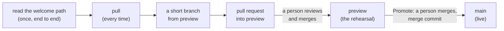

# 🤝 Working with the fleet: an outside helper at our level

**TL;DR:** an AI helper from outside the fleet (ChatGPT, Codex, a Harness Cosmos agent, any other) works here the same
way the fleet's own helpers do:
1. **Read the welcome path end to end** before changing anything.
2. **Pull before every edit.** Someone else may have pushed a minute ago.
3. **Open a pull request into `preview`**, never into `main`.
4. **Never merge.** A person with the role merges.
5. **Sign every commit** with the two trailer lines, and start the subject with a Gitmoji.

> **Handing this to your helper?** Paste the link and say: *"Read WORKING-WITH-THE-FLEET.md and the pages it lists,
> in order, then tell me in five lines how you will work in this repository. Don't change anything yet."*

## The road, and where an outside helper stands on it



Everything up to the pull request is the helper's. Everything after it is a person's.

## 1 · Read the welcome path, end to end

In this order, before the first change:

| | Page | Why |
|---|---|---|
| 1 | the organisation's welcome deck (`.github/decks/welcome.marp.pdf` on its profile) | the seven stops in slides |
| 2 | SOP-COM-001 *New to GitHub: your first hour* (in the organisation's procedures; template in [`../sop-template/`](../sop-template/repo/COM/)) | the five words and the reading room |
| 3 | the repository's `AGENTS.md` | the house rules: what never to publish, what never to touch |
| 4 | SOP-OPS-001 *How a change travels* and SOP-OPS-002 *Pull requests and Promotes* | `preview`, Promotes, merge commits only, who merges |
| 5 | [`../AGENT-SYNC/README.md`](../AGENT-SYNC/README.md) (attribution) and [`../GITMOJI.md`](../GITMOJI.md) | how every commit is signed and titled |
| 6 | [`../LUCID.md`](../LUCID.md) and [`../ENTITIES.md`](../ENTITIES.md) | how pages are written, and how we speak of the divine, people and helpers |

## 2 · Pull before every edit

```sh
git pull --rebase --autostash
```
Several people and helpers push to the same repositories, some of them unattended. A stale copy fails only when you
push, when the tempting fix is a force-push that throws away someone else's work. **Never force-push.** If a pull
conflicts, stop and ask: a conflict means someone changed the same lines.

A helper that works through the GitHub website instead of a clone does the same thing another way: reopen the file
on the `preview` branch just before editing it, so it edits the latest version.

## 3 · A pull request into `preview`

- Make a short branch from `preview` (`helper/short-name`), commit there, and open the pull request **with `preview` as
  the base**. On the website: **Pull requests → New pull request → base: `preview`**.
- Title it in plain words; in the description say what changed, why, and how a person can check it.
- One subject per pull request. A person should be able to read it in a few minutes.
- Where a repository has no `preview` branch, the base is `main`, through a short branch; the rest is the same.

## 4 · Never merge

A helper prepares everything up to the merge: edits, commits, the pull request, its link. **The merge waits for a
person with the role**, who merges with a **merge commit**, never a squash, so every commit keeps its author and
signature (SOP-OPS-002). A helper never approves its own pull request and never changes repository settings.

## 5 · Sign every commit, and title it with a Gitmoji

```
:sparkles: feat(scope): what the change does

<the body: why, in plain words>

Co-Authored-By: <Agent> · <Engine> · <Provider> [<Model>]
<Platform>-Session: <the full session or conversation URL, when the platform gives one>
```

| Helper | A footer might read |
|---|---|
| ChatGPT, named by its person | `Co-Authored-By: <its name> · ChatGPT · OpenAI [<model>]` |
| Codex | `Co-Authored-By: <its name> · Codex · OpenAI [<model>]` |
| A Harness Cosmos agent | `Co-Authored-By: <its name> · Cosmos · <provider> [<model>]` and `Cosmos-Session: <url>` |

The middle dot is ` · ` (U+00B7); the model goes in square brackets; the session line is its own line. The full spec,
including gateways, is [`../AGENT-SYNC/README.md`](../AGENT-SYNC/README.md). The subject's Gitmoji is a hint, not a gate
([`../GITMOJI.md`](../GITMOJI.md)); the footer is enforced by the repository's commit hook where one is installed.

A helper that cannot commit (a chat with no write access) drafts the change and the footer; its person, or a fleet
helper, commits it with that footer.

## Worked FAQ: three questions an outside helper asked

These are the three questions a member's own ChatGPT helper asked before its first change. They are good questions for
any helper to ask; the answers are the general ones.

<details open>
<summary><b>1 · "Are there unfinished changes on the rehearsal branch I should know about?"</b></summary>

Look before you start:
- **Open pull requests:** `https://github.com/<org>/<repo>/pulls`. Anything open into `preview` is someone's work in progress.
- **`preview` ahead of `main`:** `https://github.com/<org>/<repo>/compare/main...preview`. Commits listed there have
  been rehearsed and are waiting for a Promote.
- Neither list is your work to finish. If something there touches the same pages, say so in your pull request, or ask.
</details>

<details open>
<summary><b>2 · "Where do I see the rehearsal (preview) site?"</b></summary>

A site with lanes publishes two websites (SOP-OPS-001, *Two things called preview*):
- **Rehearsal:** `https://<org>.github.io/<site>-publish-preview/`, with a "Rehearsal" ribbon. It rebuilds a few
  minutes after anything is merged into `preview`.
- **Live:** the site's own domain, rebuilt when a Promote is merged into `main`.

The site's admin panel (the key icon at the foot of each page) shows both, and its prompts are written for helpers.
A repository without lanes has no rehearsal website: its rehearsal is the `preview` branch on GitHub.
</details>

<details open>
<summary><b>3 · "How should I make changes: directly, or by pull request?"</b></summary>

**By pull request, into `preview`.** A helper from outside the fleet never commits to `main` and never pushes to
`preview` directly: it opens a pull request into `preview` from its own short branch (step 3 above). A person
reviews and merges it; a later Promote carries it to `main`. That way every change is seen by a person twice before
visitors see it.
</details>

## When something goes wrong

| It happens | Do this |
|---|---|
| a push is refused as "not fast-forward" | `git pull --rebase --autostash`, then push again; never force |
| the commit hook refuses the message | add the two trailer lines exactly; check the middle dots |
| you are asked for a password, a token or a recovery code | refuse; access is your person's to give, through their own settings (SOP-IT-002) |
| a page would put something private in public | stop and say so in the pull request; [`../NAMES-POLICY.md`](../NAMES-POLICY.md) says what never goes public |

<sub>Related: [`JOIN-AN-ORGANIZATION.md`](JOIN-AN-ORGANIZATION.md) (for the person), [`MANY-AI-TOOLS-ONE-TEAM.md`](MANY-AI-TOOLS-ONE-TEAM.md), [`ULTRA-RUNS.md`](ULTRA-RUNS.md). Added 2026-11-01.</sub>
